# Axolotl spinal cord injury transcriptome (GSE71934)

A reproducible R re-analysis of an Affymetrix microarray study of spinal cord regeneration in the axolotl (*Ambystoma mexicanum*). The pipeline goes from raw CEL files to quality control, RMA normalisation, limma differential expression, ortholog mapping, and GO enrichment. Every figure in this README comes from one run of `run_all.R`.

**Origin.** Started as MBG455 Bioinformatics coursework (İstanbul Medeniyet University, 2024); extended and refactored as a portfolio project.

Author: Fırat Durak

## Question

Axolotls regenerate a functional spinal cord after injury. The study behind this dataset (Sabin et al., *Dev Biol* 2015;408(1):14-25, [doi:10.1016/j.ydbio.2015.10.012](https://doi.org/10.1016/j.ydbio.2015.10.012)) reports that injury changes the membrane potential of ependymoglial cells, and identifies c-Fos as a voltage-sensitive early-response gene. This project asks two narrower questions of the public arrays:

1. Which genes change in spinal cord tissue at 1, 3, and 7 days post injury (dpi) compared with uninjured tissue?
2. How does the transcriptome of injured tissue treated with ivermectin compare with untreated injured tissue at 1 dpi?

## Dataset

| | |
|---|---|
| GEO series | [GSE71934](https://www.ncbi.nlm.nih.gov/geo/query/acc.cgi?acc=GSE71934) |
| Platform | [GPL15153](https://www.ncbi.nlm.nih.gov/geo/query/acc.cgi?acc=GPL15153), Affymetrix AMBY_002 20k array, custom CDF `AMBY_002a520748F` |
| Arrays | 15, three per group. GEO states that each array pools tissue from 10 animals. |
| Groups | Uninjured, 1 dpi, 3 dpi, 7 dpi, 1 dpi + ivermectin |

`metadata/samples.csv` maps each GSM accession to its CEL file and group.

## Methods

1. **Download.** `R/01_download.R` fetches the raw CEL archive and the binary CDF from GEO, and the GPL15153 annotation table with GEOquery. No Bioconductor CDF package exists for this array, so `makecdfenv` builds the CDF environment from the GEO file.
2. **QC and normalisation.** `R/02_preprocess_qc.R` plots raw probe intensities, runs RMA (background correction, quantile normalisation, median-polish summarisation), and checks the result with relative log expression (RLE), PCA, and sample-to-sample correlation clustering. It also records each array's scan date from the CEL headers.
3. **Differential expression.** `R/03_differential_expression.R` fits one limma model to all 15 arrays (`~ 0 + group`) and tests four contrasts with empirical Bayes moderation. A probeset counts as differentially expressed (DE) at Benjamini-Hochberg adjusted p < 0.05 and |log2 fold change| >= 1.
4. **Annotation and enrichment.** `R/04_enrichment.R` maps probesets to human Entrez genes through the platform's "presumptive human ortholog" symbols, first as official symbols and then as unambiguous aliases in `org.Hs.eg.db`. It keeps the most significant probeset per gene and runs `limma::goana` for GO Biological Process terms of 10 to 500 genes. The universe is every gene the array maps to, not the whole human genome.

| Contrast | Meaning |
|---|---|
| `dpi1_vs_uninjured` | 1 dpi vs uninjured |
| `dpi3_vs_uninjured` | 3 dpi vs uninjured |
| `dpi7_vs_uninjured` | 7 dpi vs uninjured |
| `ivermectin_vs_dpi1` | 1 dpi + ivermectin vs 1 dpi |

## Results

### The arrays are clean and the groups separate

Raw intensity distributions are similar across arrays, and RMA aligns them. Replicates within each group correlate at Pearson r >= 0.997. PC1 explains 66.5% of the variance and separates the injured time points from uninjured tissue. The ivermectin-treated arrays sit next to the uninjured arrays, not next to untreated 1 dpi.

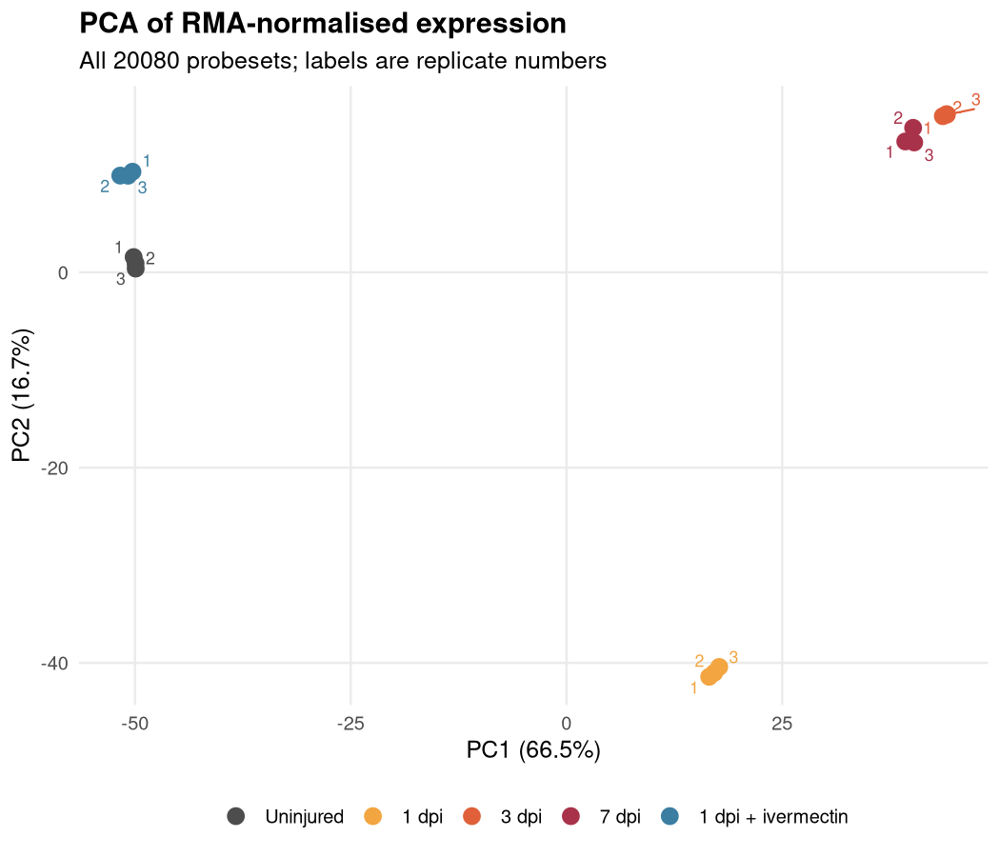

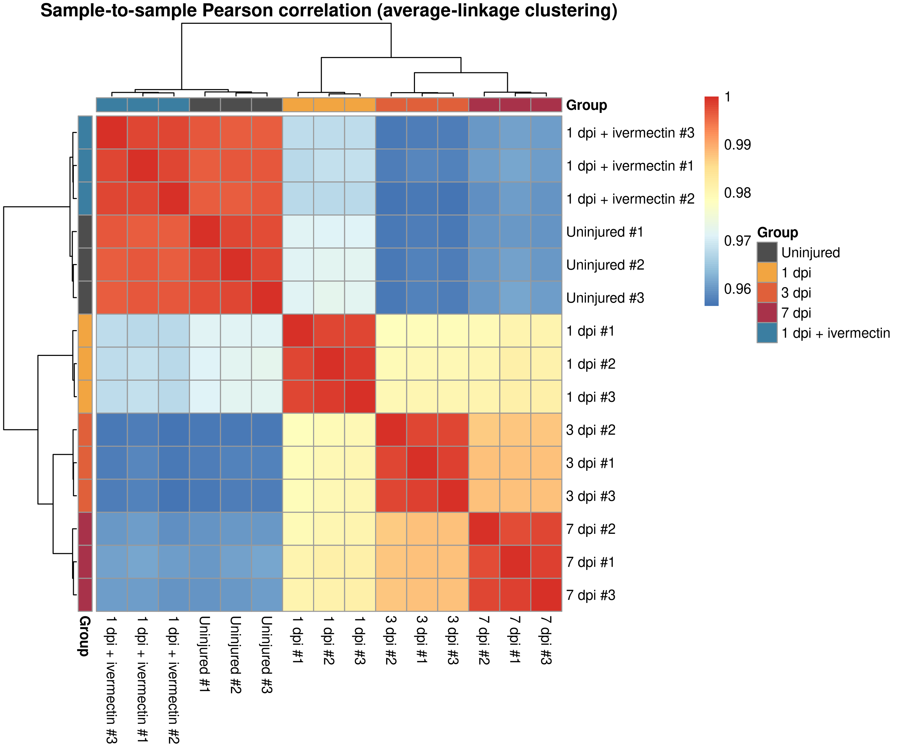

<details>
<summary>More QC figures</summary>

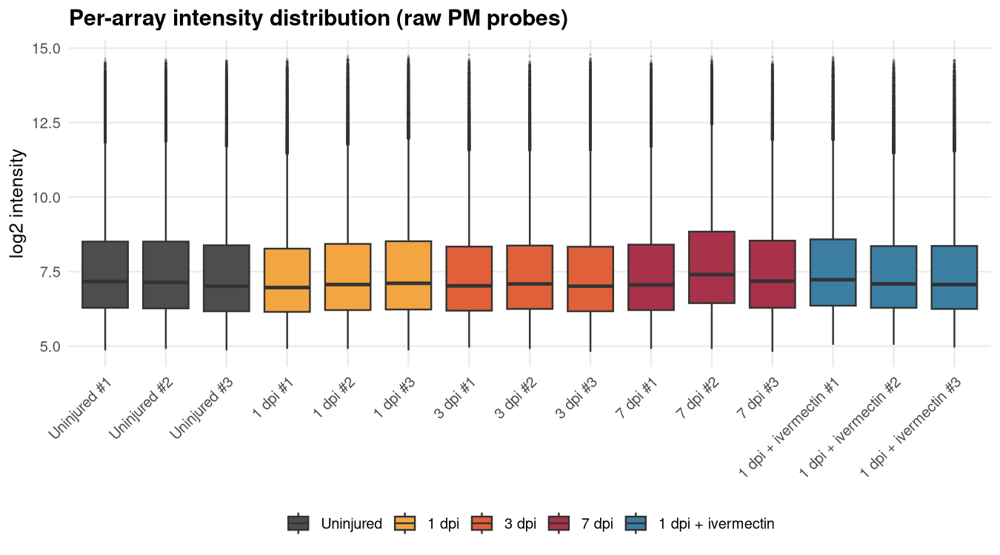
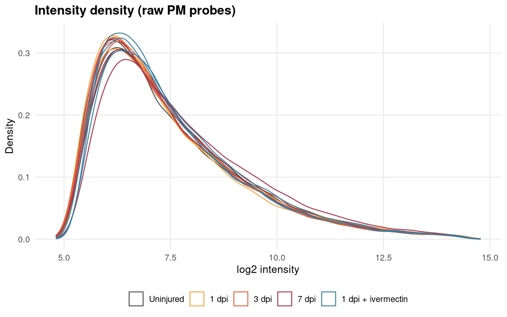
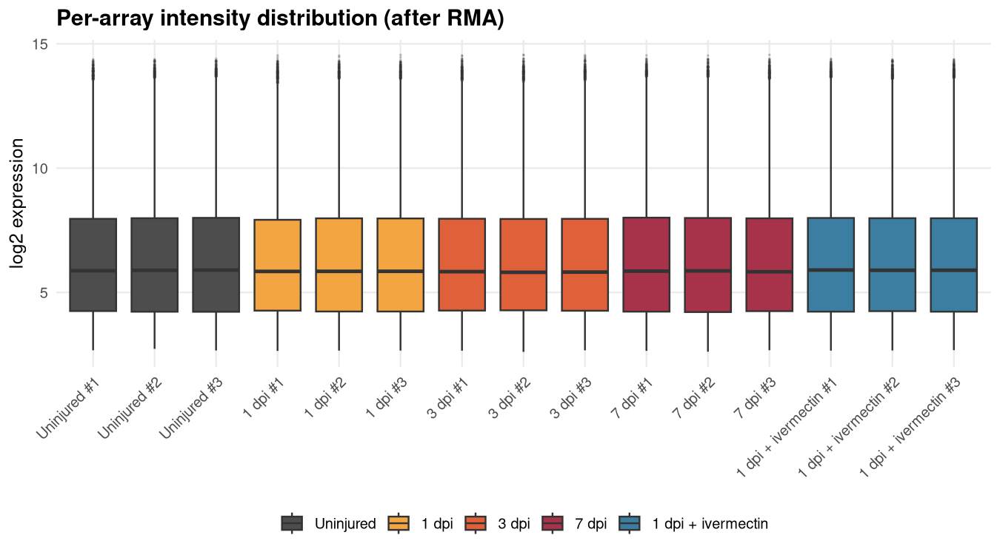
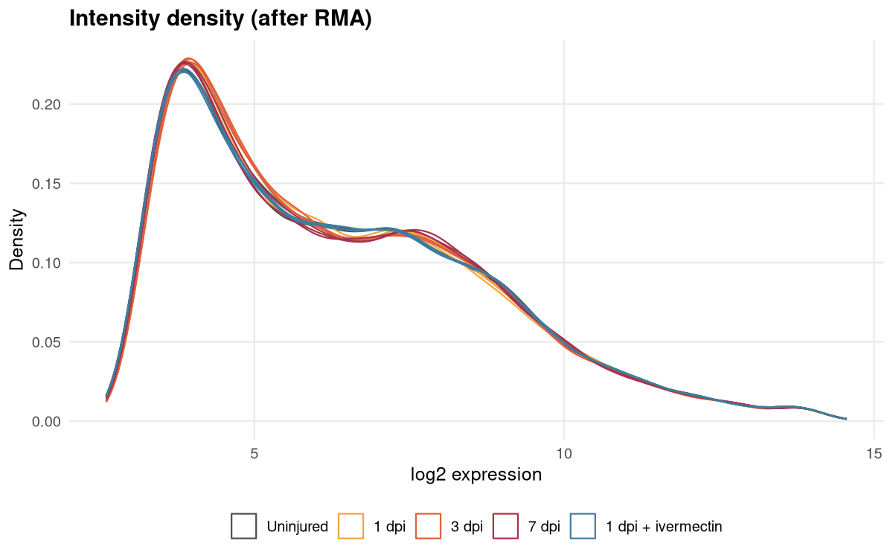
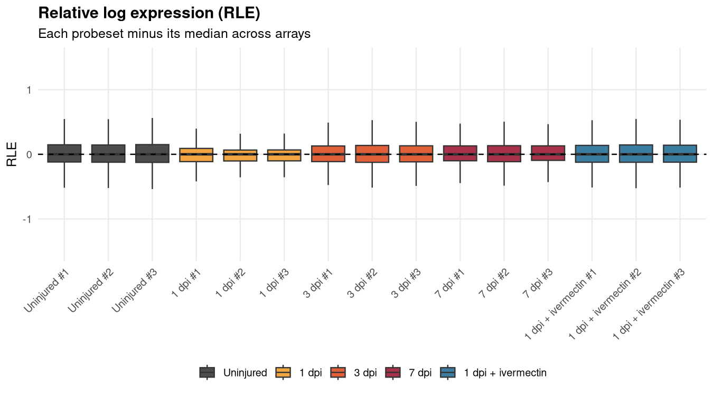

</details>

### About 1,400 to 2,200 probesets change after injury

| Contrast | Up | Down | Total DE probesets | Distinct ortholog symbols |
|---|---:|---:|---:|---:|
| 1 dpi vs uninjured | 723 | 703 | 1,426 | 951 |
| 3 dpi vs uninjured | 957 | 1,225 | 2,182 | 1,445 |
| 7 dpi vs uninjured | 998 | 1,106 | 2,104 | 1,375 |
| Ivermectin 1 dpi vs 1 dpi | 787 | 776 | 1,563 | 1,032 |

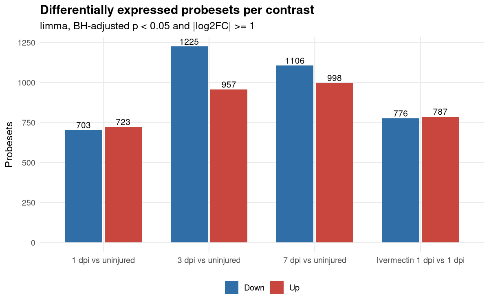

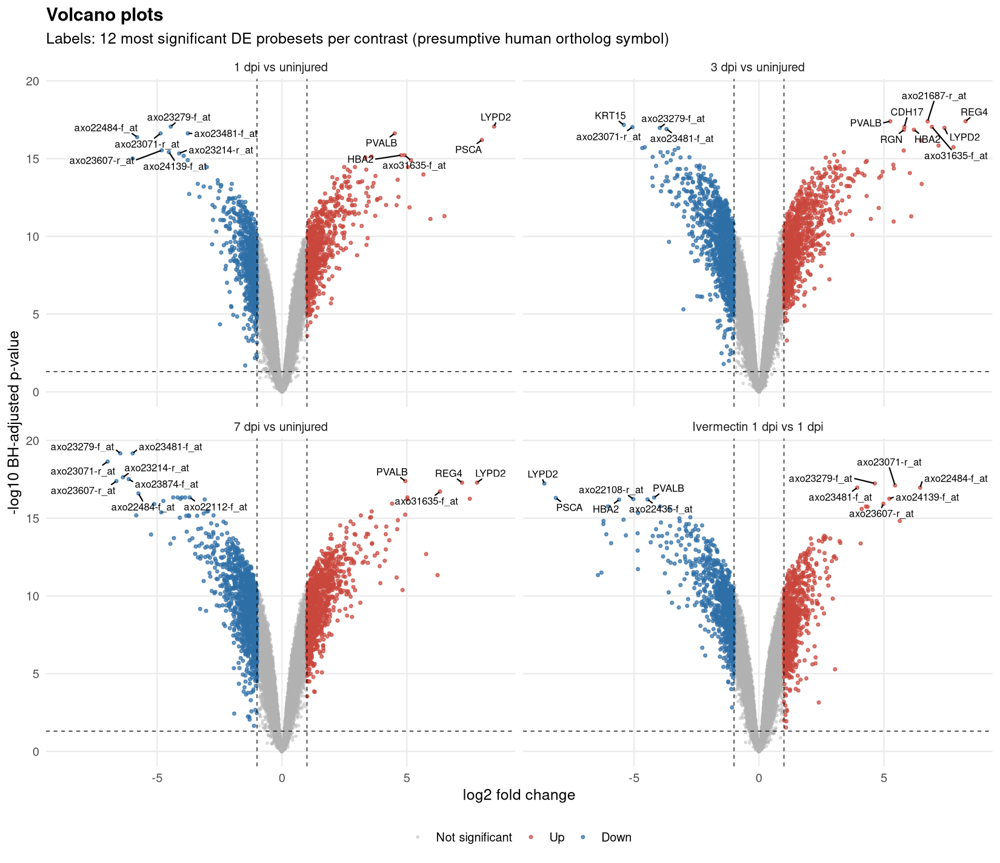

The heatmap shows the 50 probesets with the strongest moderated F-statistic across the three time-point contrasts. One block peaks at 1 dpi, including FOS, NFKBIA, TIMP1, and several MMPs. A second block rises from 3 dpi, and a third falls in every injured group.

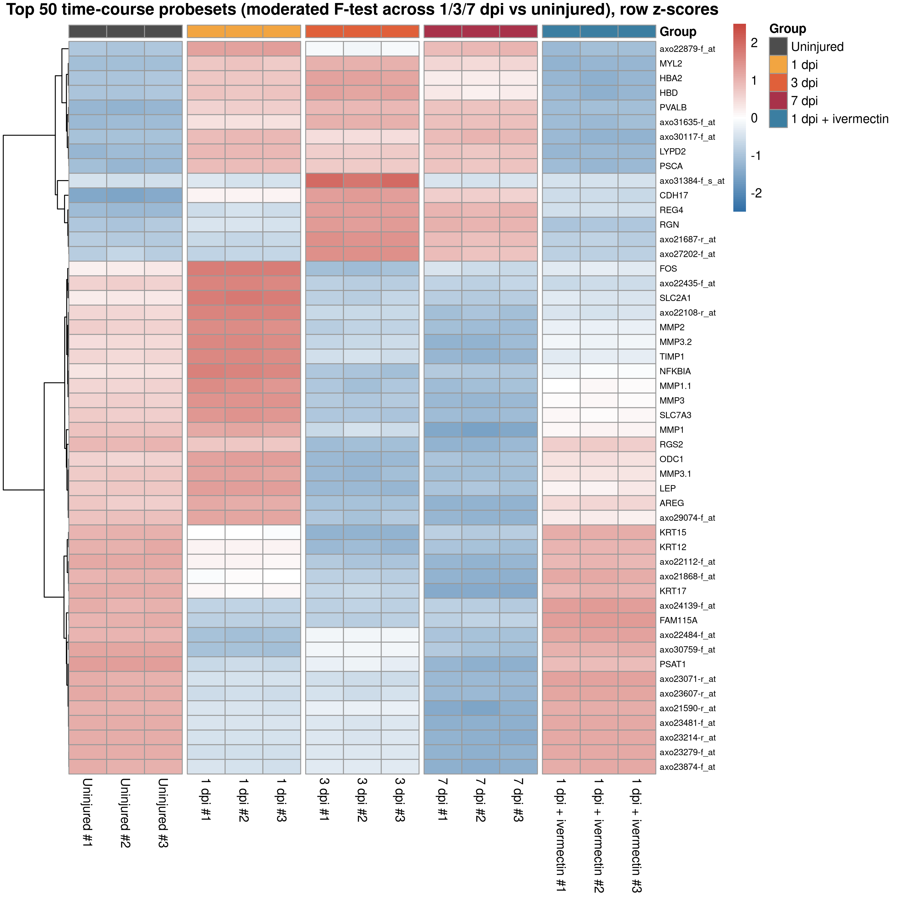

Full per-contrast tables are regenerated in `data/processed/`. The 50 most significant DE probesets per contrast are committed in `results/top50_de_*.csv`.

### FOS rises at 1 dpi and falls below baseline later

The FOS probeset (`axo10931-f_at`) is up 2.65 log2 units at 1 dpi, then down 2.40 at 3 dpi and 1.45 at 7 dpi, all against uninjured tissue. In ivermectin-treated tissue it is 3.68 log2 units lower than in untreated 1 dpi tissue. The 1 dpi rise agrees with the study's description of c-Fos as an early injury-response gene.

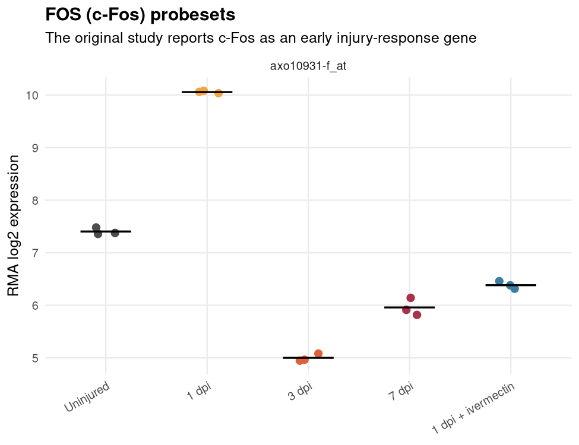

### The ivermectin arrays look like uninjured tissue

Only 32 probesets pass the DE thresholds between ivermectin-treated 1 dpi tissue and uninjured tissue, against 1,426 between untreated 1 dpi and uninjured tissue. For those 1,426 probesets, the median |log2 fold change| against uninjured tissue is 1.31 in untreated 1 dpi tissue and 0.15 in ivermectin-treated tissue. `results/ivermectin_vs_injury_response.csv` holds these numbers.

The data shows that the ivermectin group lacks most of the 1 dpi injury signature. It cannot show why. GEO mentions a water vehicle but does not identify any array as vehicle-injected. The GEO protocol describes surgical removal of a spinal cord segment for the ivermectin experiment, while the CEL file names of the time-course groups contain `Crush`, so the injury method may also differ between the groups (an inference from file names only). The arrays alone cannot separate a drug effect from these differences.

### GO enrichment points to muscle, cilia, cell cycle, and epidermis

613 distinct GO Biological Process terms pass FDR < 0.05 in at least one contrast and direction (1,233 rows in `results/go_bp_enrichment_fdr05.csv`).

- Up at 1 dpi: cilium movement and cilium-dependent motility terms rank first.
- Up at 1, 3, and 7 dpi: muscle contraction, myofibril assembly, and sarcomere organisation.
- Down at 1 and 3 dpi: DNA replication, mitotic nuclear division, and other cell-cycle terms.
- Down at 1, 3, and 7 dpi: epidermis development. Keratinocyte differentiation is down at 3 and 7 dpi.
- Ivermectin vs 1 dpi reverses the 1 dpi pattern, with cell-cycle terms up and muscle terms down.

Any of these terms can reflect how much surrounding tissue each dissection included, or a shift in cell-type composition, not only regulation inside spinal cord cells. The muscle and epidermis terms are the most obvious candidates. These arrays cannot tell the explanations apart.

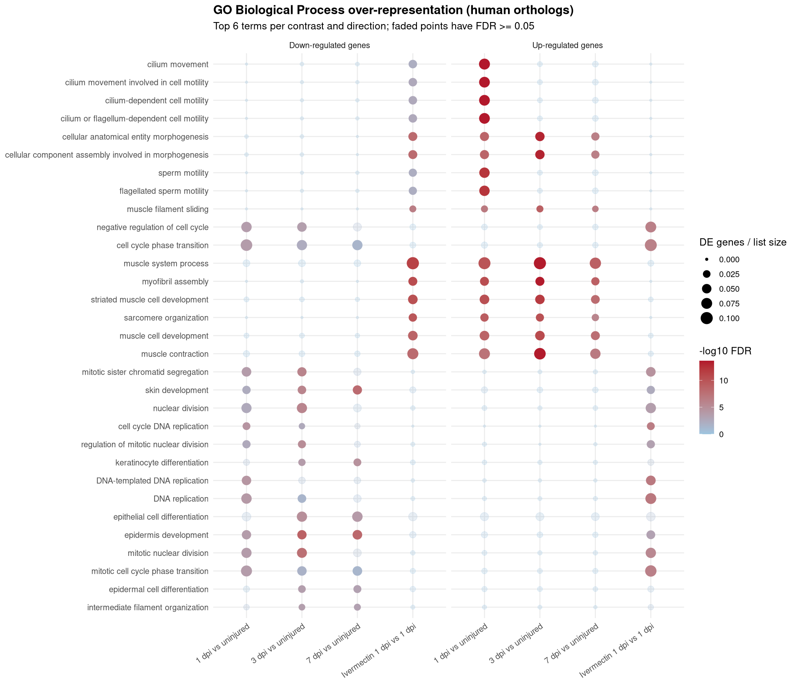

### The refactor reproduces the coursework result

The original coursework reported 1,651 DE genes for 3 dpi vs uninjured. This pipeline finds 2,182 DE probesets for the same contrast. Of those, 1,651 carry a human ortholog symbol, which matches the coursework count exactly. Fitting the model on all 15 arrays instead of the original 6 does not change the 3 dpi count.

## Limitations

- **Uninjured arrays were scanned on a separate day.** The three uninjured arrays were scanned on 2012-11-29 and every other array on 2012-12-11 or 2012-12-12 (`results/array_scan_dates.csv`). Every injury-vs-uninjured contrast is therefore partly confounded with scan day. The ivermectin arrays shared a scan day with 1 dpi replicate 1, which still clusters with its own group, so scan day alone does not explain the ivermectin result.
- **Orthology is presumptive.** The platform assigns human symbols by sequence similarity from an older axolotl assembly. 27% of probesets have no symbol, several probesets can share one symbol, and the mapping is not curated one-to-one orthology. Enrichment results describe human gene sets, not axolotl biology directly.
- **Some top hits have no ortholog.** Seven probesets carry best-hit annotations to Influenza B virus proteins. All seven are down at 1 dpi, six of the seven are highly expressed, and several appear among the strongest hits in the volcano plots and heatmap. The annotation does not say what they measure.
- **The samples are pooled tissue.** Each array pools 10 animals, so the arrays capture pool means and not animal-to-animal variation. Pooling reduces variance between arrays, so the p-values describe differences between pools of animals, with three pools per group.
- **Fold changes come from bulk tissue.** A change can come from a shift in cell-type composition as well as from regulation inside one cell type.

## How to run

You need R 4.6, a C compiler, and `gfortran` (limma depends on `statmod`, which compiles Fortran). On Arch Linux, install the compiler with `pacman -S gcc-fortran`. On Debian or Ubuntu, install `gfortran`.

1. Clone the repository and open R in its root. renv bootstraps itself from `.Rprofile`.
2. Restore the locked package versions:

	```r
	renv::restore()
	```

3. Run the pipeline from the shell:

	```sh
	Rscript run_all.R
	```

The run downloads about 23 MB from GEO into `data/raw/`, writes intermediate files to `data/processed/`, and rewrites `figures/` and `results/`. After the download, the analysis takes about 1.5 minutes on a 16-core laptop. Re-running skips downloads already on disk.

If your system locale is Turkish (`tr_TR`), set `LC_ALL=C.UTF-8` for the restore and for the run. Under `tr_TR`, the dotted and dotless "i" break package installation for `R.oo` and `Biostrings`.

## Repository layout

| Path | Contents |
|---|---|
| `run_all.R` | Runs the four steps in order and saves `results/sessionInfo.txt` |
| `R/config.R` | Paths, GEO URLs, group labels and colours, the contrast table, DE thresholds |
| `R/01_download.R` to `R/04_enrichment.R` | Pipeline steps |
| `metadata/samples.csv` | Sample sheet |
| `figures/` | PNG figures from the last run |
| `results/` | Small result tables from the last run |
| `renv.lock` | Locked R and Bioconductor 3.24 package versions |

## Licence

MIT. See `LICENSE`.
